# Jarkom-Modul-3-2026-K-38

**Kelompok** : K-38

**Anggota** :

| Nama                 | NRP        | Soal  |
| -------------------- | ---------- | ----- |
| Farrel Arteya Kumara | 5027251020 | 1-10  |
| Nayla Arsha Adyuta   | 5027251042 | 11-20 |

<br/>

**Topologi**

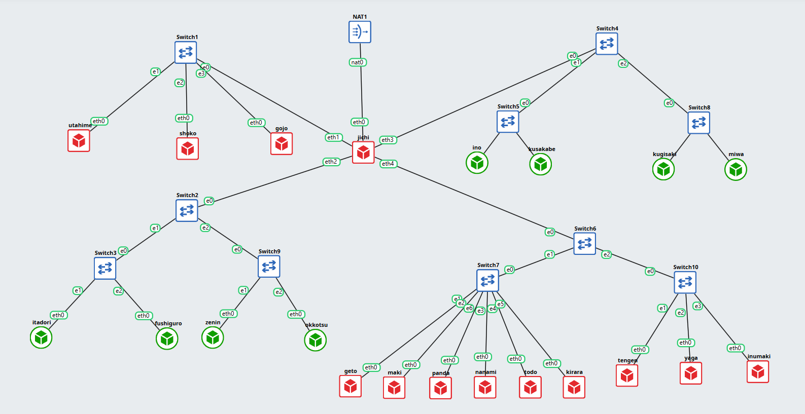

<br/>

#### Soal 1

Konfigurasi router **jichi**: eth0 ke NAT (DHCP), eth1-eth4 diberi IP statis `192.230.X.1/24`, aktifkan IP forwarding, dan pasang NAT (MASQUERADE) supaya seluruh network bisa keluar ke internet.

Jalankan `setup-1.sh` di node `jichi` <br/>

```bash
#!/bin/bash
cat <<INTERFACES > /etc/network/interfaces
auto lo
iface lo inet loopback

auto eth0
iface eth0 inet dhcp

auto eth1
iface eth1 inet static
    address 192.230.1.1
    netmask 255.255.255.0

auto eth2
iface eth2 inet static
    address 192.230.2.1
    netmask 255.255.255.0

auto eth3
iface eth3 inet static
    address 192.230.3.1
    netmask 255.255.255.0

auto eth4
iface eth4 inet static
    address 192.230.4.1
    netmask 255.255.255.0
INTERFACES

ip link set eth0 up
dhclient eth0 2>/dev/null || udhcpc -i eth0 -n -q 2>/dev/null || true

for i in 1 2 3 4; do
  ip link set eth$i up
  ip addr replace 192.230.$i.1/24 dev eth$i
done

sysctl -w net.ipv4.ip_forward=1
grep -q '^net.ipv4.ip_forward=1' /etc/sysctl.conf || echo "net.ipv4.ip_forward=1" >> /etc/sysctl.conf

export DEBIAN_FRONTEND=noninteractive
apt-get update && apt-get install -y iptables iptables-persistent

iptables -t nat -C POSTROUTING -o eth0 -j MASQUERADE 2>/dev/null || iptables -t nat -A POSTROUTING -o eth0 -j MASQUERADE
netfilter-persistent save 2>/dev/null || true
```

```bash
bash setup-1.sh
```

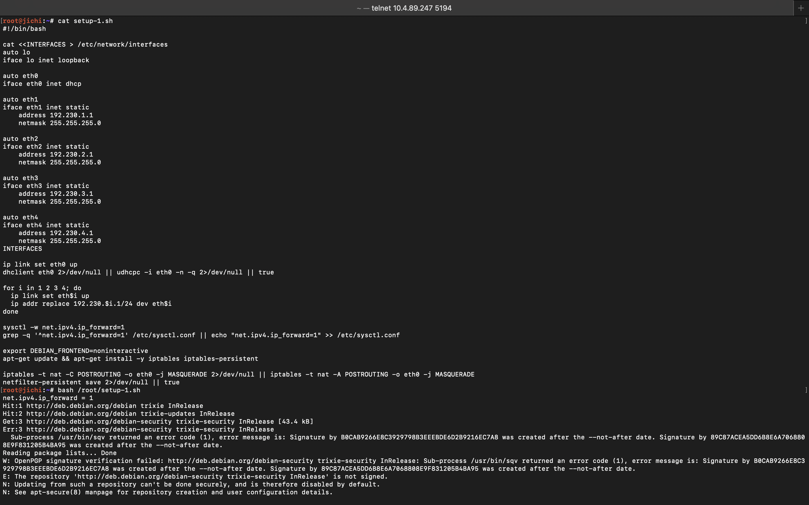

Cek di node `jichi`

```bash
ip -br a
ip route
sysctl net.ipv4.ip_forward
iptables -t nat -L POSTROUTING -n -v
ping -c 2 8.8.8.8
```

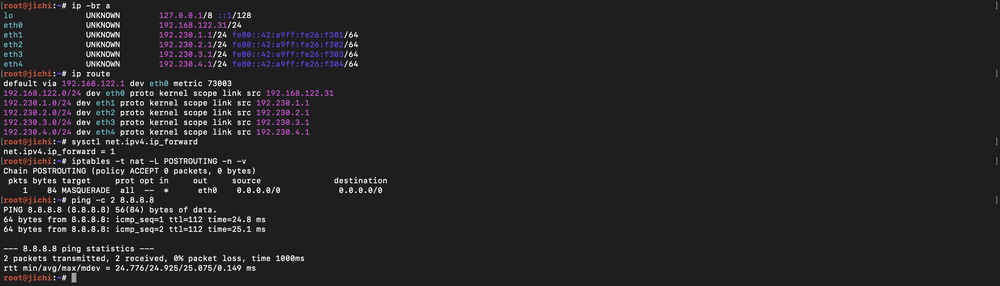

<br/>

#### Soal 2

Konfigurasi **DHCP Server** di node **tengen** (`192.230.4.10`). DHCP server melayani interface eth0 (Network 4), dengan DNS server `192.230.1.2` dan `192.230.1.3`, serta scope dasar untuk Network 2 dan Network 3.

Jalankan `setup-2.sh` di node `tengen` <br/>

```bash
#!/bin/bash
cat <<INTERFACES > /etc/network/interfaces
auto lo
iface lo inet loopback

auto eth0
iface eth0 inet static
    address 192.230.4.10
    netmask 255.255.255.0
    gateway 192.230.4.1
INTERFACES

ip link set eth0 up
ip addr flush dev eth0
ip addr add 192.230.4.10/24 dev eth0
ip route replace default via 192.230.4.1
echo "nameserver 8.8.8.8" > /etc/resolv.conf

export DEBIAN_FRONTEND=noninteractive
apt-get update
apt-get install -y isc-dhcp-server

# Atur interface DHCP server mengarah ke Network 4 (eth0)
sed -i 's/^INTERFACESv4=.*/INTERFACESv4="eth0"/' /etc/default/isc-dhcp-server

cat <<DHCPCONF > /etc/dhcp/dhcpd.conf
authoritative;
default-lease-time 600;
max-lease-time 7200;

option domain-name "K38.com";
option domain-search "K38.com";
option domain-name-servers 192.230.1.2, 192.230.1.3;

# Network 4 sebagai subnet lokal tanpa pool dinamis
subnet 192.230.4.0 netmask 255.255.255.0 {
}

# Scope dasar Network 2
subnet 192.230.2.0 netmask 255.255.255.0 {
    option routers 192.230.2.1;
}

# Scope dasar Network 3
subnet 192.230.3.0 netmask 255.255.255.0 {
    option routers 192.230.3.1;
}
DHCPCONF

service isc-dhcp-server restart
```

```bash
bash setup-2.sh
```

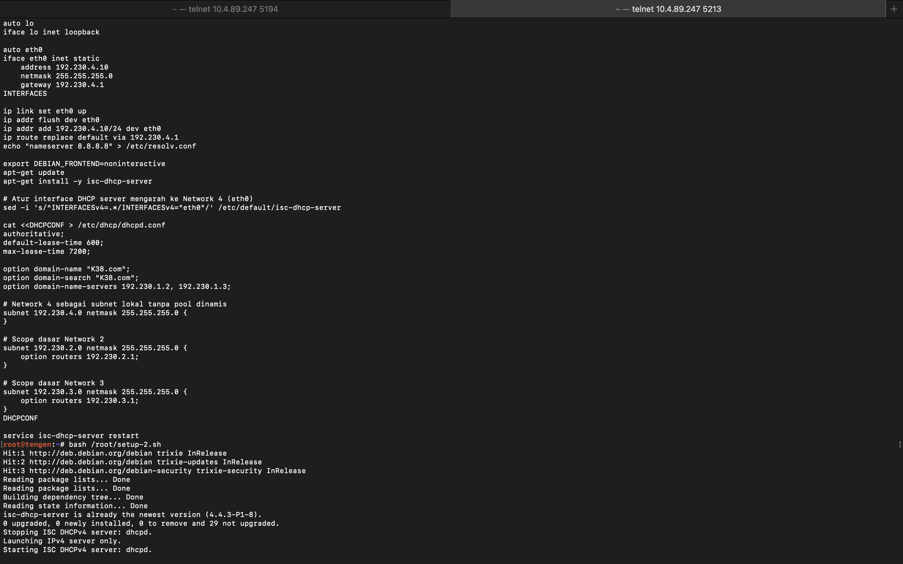

Cek di node `tengen`

```bash
ping -c 2 8.8.8.8
dhcpd -t -cf /etc/dhcp/dhcpd.conf
service isc-dhcp-server status
```

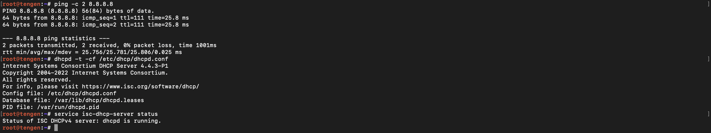

<br/>

#### Soal 3

Konfigurasi **DHCP Relay** di node **jichi** supaya broadcast DHCP dari Network 2, 3, dan 4 diteruskan ke DHCP Server tengen (`192.230.4.10`).

Jalankan `setup-3.sh` di node `jichi` <br/>

```bash
#!/bin/bash
TENGEN_IP="192.230.4.10"

export DEBIAN_FRONTEND=noninteractive
apt-get update
apt-get install -y isc-dhcp-relay

cat <<RELAY > /etc/default/isc-dhcp-relay
SERVERS="${TENGEN_IP}"
INTERFACES="eth2 eth3 eth4"
OPTIONS=""
RELAY

service isc-dhcp-relay restart
```

```bash
bash setup-3.sh
```

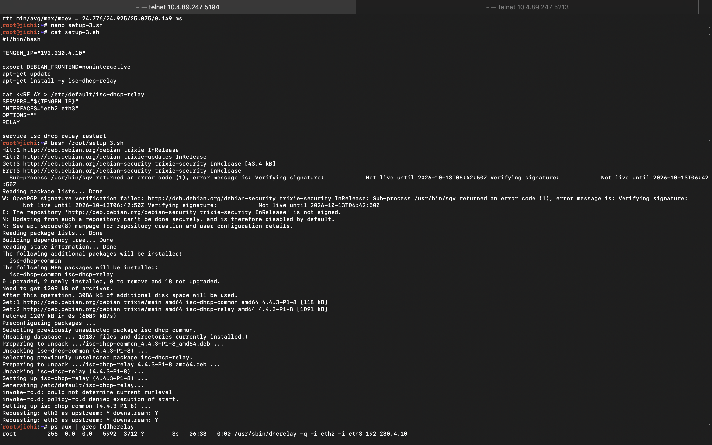

Cek di node `jichi`

```bash
ps aux | grep [d]hcrelay
```

<br/>

#### Soal 4

Atur **DHCP pool di Network 2 (Divisi A)** dengan 2 pool berbeda berdasarkan MAC address client:

- Pool 1 (`192.230.2.10 - 192.230.2.35`) untuk **itadori** & **fushiguro**
- Pool 2 (`192.230.2.70 - 192.230.2.95`) untuk **zenin** & **okkotsu**

Ambil MAC address di node `itadori`, `fushiguro`, `zenin`, `okkotsu` (pakai MAC milik eth0)

```bash
ip -br link
```

| Node      | MAC eth0          |
| --------- | ----------------- |
| itadori   | 02:42:de:08:46:00 |
| fushiguro | 02:42:83:bb:88:00 |
| zenin     | 02:42:f2:c3:5f:00 |
| okkotsu   | 02:42:c7:86:f0:00 |

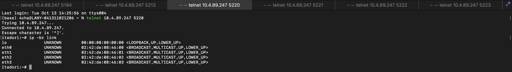

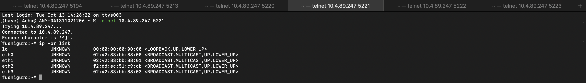

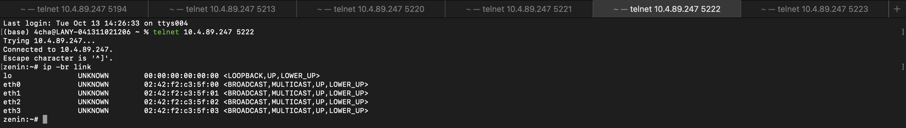

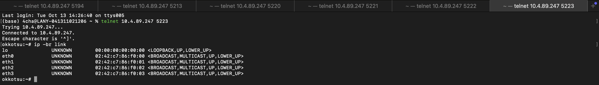

Jalankan `setup-4.sh` di node `tengen` <br/>

```bash
#!/bin/bash
MAC_ITADORI="02:42:de:08:46:00"
MAC_FUSHIGURO="02:42:83:bb:88:00"
MAC_ZENIN="02:42:f2:c3:5f:00"
MAC_OKKOTSU="02:42:c7:86:f0:00"

cat <<'EOF' > /etc/dhcp/dhcpd.conf
authoritative;
default-lease-time 600;
max-lease-time 7200;

option domain-name "K38.com";
option domain-search "K38.com";
option domain-name-servers 192.230.1.2, 192.230.1.3;

# Kelas untuk Pool 1 (Itadori & Fushiguro)
class "pool-1-clients" {
    match if (substring(hardware, 1, 6) = 02:42:de:08:46:00) or (substring(hardware, 1, 6) = 02:42:83:bb:88:00);
}

# Subnet Network 4 (Lokal Tengen)
subnet 192.230.4.0 netmask 255.255.255.0 {
}

# Subnet Network 2 dengan Dual Pool
subnet 192.230.2.0 netmask 255.255.255.0 {
    option routers 192.230.2.1;
    option broadcast-address 192.230.2.255;

    # Pool 1 untuk Itadori & Fushiguro
    pool {
        allow members of "pool-1-clients";
        range 192.230.2.10 192.230.2.35;
    }

    # Pool 2 untuk Zenin & Okkotsu (selain Pool 1)
    pool {
        deny members of "pool-1-clients";
        range 192.230.2.70 192.230.2.95;
    }
}

# Subnet Network 3 (Dasar)
subnet 192.230.3.0 netmask 255.255.255.0 {
    option routers 192.230.3.1;
}
EOF

# Validasi dan Restart DHCP Server
dhcpd -t -cf /etc/dhcp/dhcpd.conf && service isc-dhcp-server restart
```

```bash
bash setup-4.sh
```

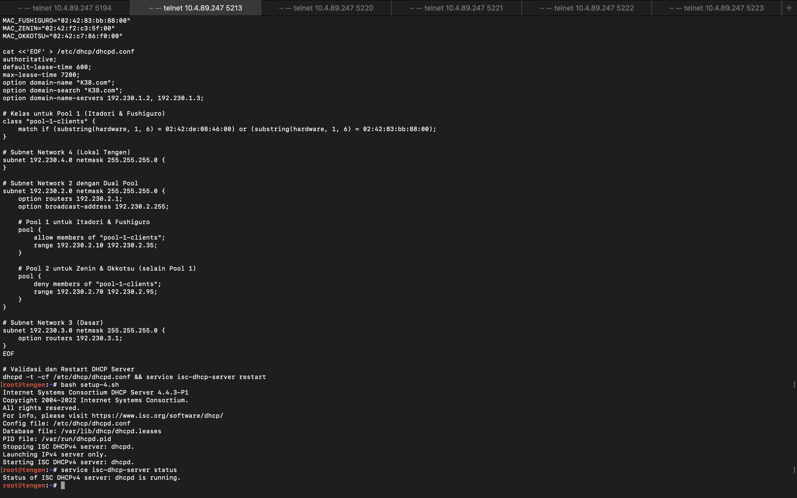

Cek di node `tengen`

```bash
dhcpd -t -cf /etc/dhcp/dhcpd.conf
service isc-dhcp-server status   # harus running
```

Cek di client yang mewakili masing-masing pool (`itadori` & `zenin`)

```bash
udhcpc -i eth0 -n
```

- Pool 1 (itadori) seharusnya mendapat IP di kisaran `192.230.2.10`
- Pool 2 (zenin) seharusnya mendapat IP di kisaran `192.230.2.70`

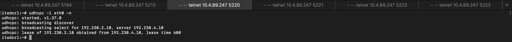

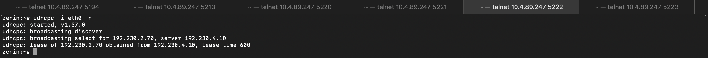

<br/>

#### Soal 5

Atur **lease time dan DHCP options di Network 3 (Divisi B)**:

- **ino** & **kusakabe** : short lease 30 menit (1800 detik), range `192.230.3.10 - 192.230.3.89`
- **miwa** : long lease 12 jam (43200 detik), range `192.230.3.100 - 192.230.3.199`

Ambil MAC address di node `ino`, `kusakabe`, `miwa`

```bash
ip -br link
```

| Node     | MAC eth0          |
| -------- | ----------------- |
| ino      | 02:42:eb:98:67:00 |
| kusakabe | 02:42:ce:17:22:00 |
| miwa     | 02:42:61:27:3d:00 |

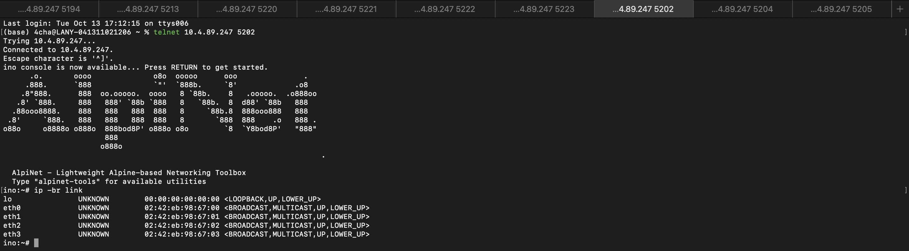

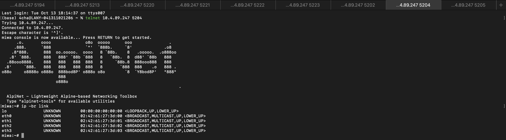

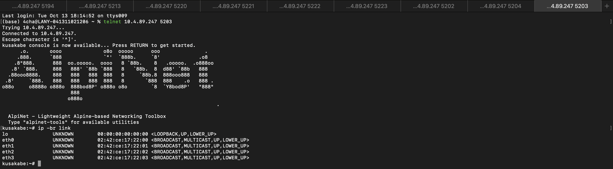

Jalankan `setup-5.sh` di node `tengen` <br/>

```bash
#!/bin/bash
MAC_INO="02:42:eb:98:67:00"
MAC_KUSAKABE="02:42:ce:17:22:00"
MAC_MIWA="02:42:61:27:3d:00"

cat <<DHCPCONF >> /etc/dhcp/dhcpd.conf
class "short-lease-clients" {
    match if (substring(hardware, 1, 6) = ${MAC_INO}) or (substring(hardware, 1, 6) = ${MAC_KUSAKABE});
}

class "long-lease-clients" {
    match if (substring(hardware, 1, 6) = ${MAC_MIWA});
}

subnet 192.230.3.0 netmask 255.255.255.0 {
    option routers 192.230.3.1;
    option domain-name-servers 192.230.1.2, 192.230.1.3;
    option domain-search "K38.com";

    # Short Lease (30 menit / 1800 detik)
    pool {
        allow members of "short-lease-clients";
        range 192.230.3.10 192.230.3.89;
        default-lease-time 1800;
        max-lease-time 1800;
    }

    # Long Lease (12 jam / 43200 detik)
    pool {
        allow members of "long-lease-clients";
        range 192.230.3.100 192.230.3.199;
        default-lease-time 43200;
        max-lease-time 43200;
    }
}
DHCPCONF

dhcpd -t -cf /etc/dhcp/dhcpd.conf && service isc-dhcp-server restart
```

```bash
bash setup-5.sh
```

> **Catatan:** di catatan awal `option domain-search` tertulis `"K01.com"`, di sini sudah disesuaikan menjadi `"K38.com"`. Subnet `192.230.3.0` juga sudah dideklarasikan di `setup-4.sh`, jadi dhcpd akan menampilkan warning _subnet overlaps_ — ini hanya warning, service tetap jalan.

Cek di client `ino` atau `miwa`

```bash
udhcpc -i eth0 -n
```

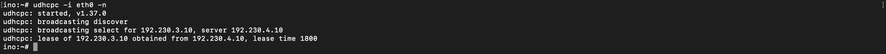

Cek di node `tengen`

```bash
cat /var/lib/dhcp/dhcpd.leases
```

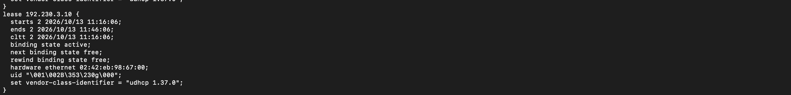

Selisih waktu `starts` dan `ends` pada lease record harus sesuai (1800 detik untuk ino/kusakabe, 43200 detik untuk miwa).

<br/>

#### Soal 6

Buat **DHCP static lease untuk kugisaki** agar selalu mendapat IP `192.230.3.99` (di luar pool dinamis Network 3).

Jalankan `setup-6.sh` di node `tengen` <br/>

```bash
#!/bin/bash
MAC_KUGISAKI="02:42:06:35:1a:00"

cat <<DHCPCONF >> /etc/dhcp/dhcpd.conf

# Static lease untuk kugisaki di luar pool dinamis Network 3
host kugisaki {
    hardware ethernet ${MAC_KUGISAKI};
    fixed-address 192.230.3.99;
}
DHCPCONF

dhcpd -t -cf /etc/dhcp/dhcpd.conf && service isc-dhcp-server restart
```

```bash
bash setup-6.sh
```

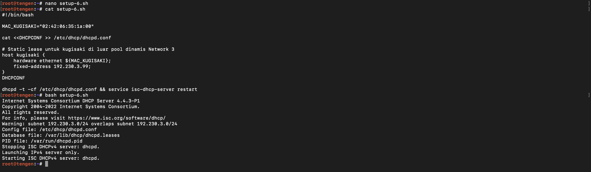

Cek di node `kugisaki`

```bash
udhcpc -i eth0 -n
```

Output seharusnya mendapatkan IP `192.230.3.99`.

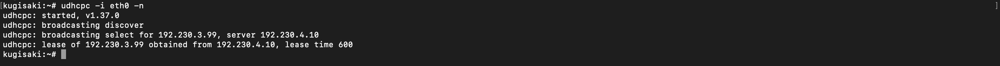

<br/>

#### Soal 7

**Validasi konfigurasi client dan lease file** di DHCP Server (status service, IP, gateway, DNS, dan database lease terbaru).

Jalankan `setup-7.sh` di node `tengen` <br/>

```bash
#!/bin/bash
echo "--- Cek Status DHCP Server ---"
service isc-dhcp-server status

echo "--- Cek IP & Mask ---"
ip -br a show eth0

echo "--- Cek Gateway ---"
ip route

echo "--- Cek DNS & Domain ---"
cat /etc/resolv.conf

echo "--- Cek Database Leases Terbaru ---"
tail -n 15 /var/lib/dhcp/dhcpd.leases
```

```bash
bash setup-7.sh
```

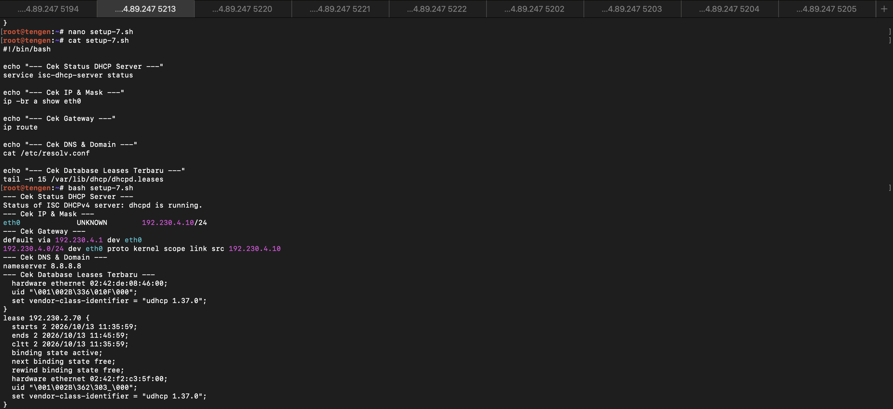

Cek file lease secara lengkap di node `tengen`

```bash
cat /var/lib/dhcp/dhcpd.leases
```

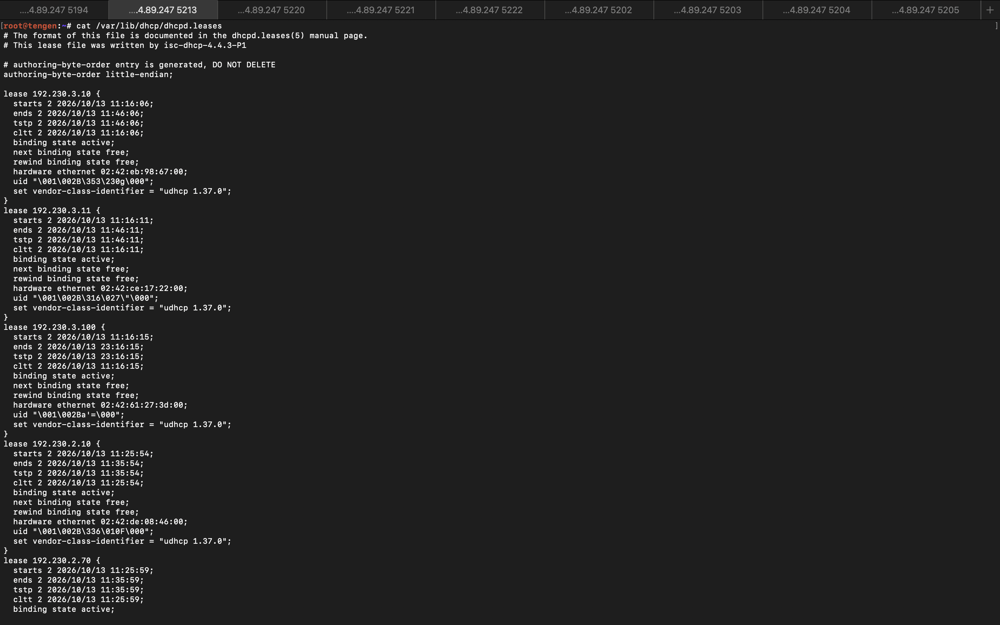

<br/>

#### Soal 8

Gunakan **tcpdump** di tengen untuk melihat alur DHCP (DISCOVER, OFFER, REQUEST, ACK).

Jalankan di node `tengen`

```bash
tcpdump -i eth0 -nn -v port 67 or port 68
```

Minta IP di client (misal `itadori`)

```bash
udhcpc -i eth0 -n
```

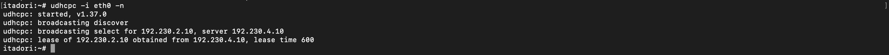

Lalu amati log di terminal tengen: urutan paket DISCOVER, OFFER, REQUEST, ACK muncul dan nilai `giaddr` terisi alamat IP router jichi (`192.230.2.1` atau `192.230.3.1`).

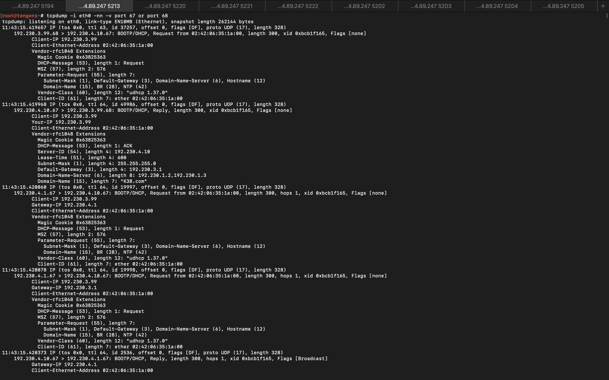

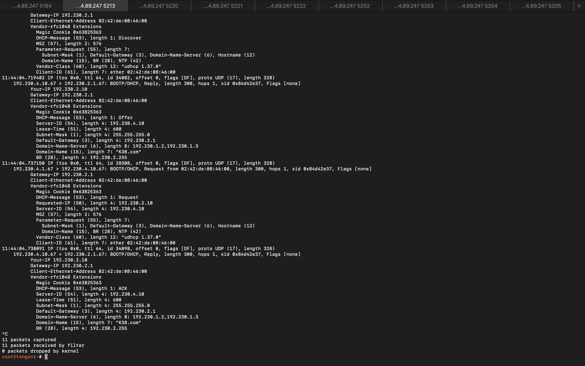

<br/>

#### Soal 9

Simulasi **gangguan DHCP relay** di jichi.

Matikan service relay di node `jichi`

```bash
service isc-dhcp-relay stop
```

Minta IP baru dari client (contoh `itadori`), seharusnya **gagal** karena discover tidak diteruskan ke tengen

```bash
udhcpc -i eth0 -n
```

Nyalakan kembali service relay di node `jichi`

```bash
service isc-dhcp-relay start
```

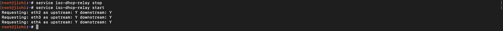

Ulangi permintaan DHCP di client dan pastikan client berhasil memperoleh IP dari pool yang benar

```bash
udhcpc -i eth0 -n
```

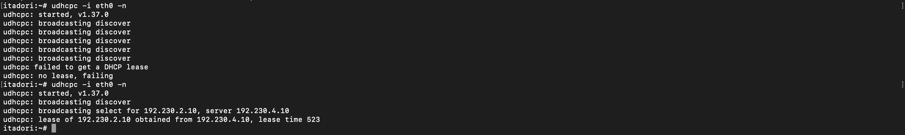

<br/>

#### Soal 10

Pastikan **DHCP server (tengen)** dan **DHCP relay (jichi)** berjalan otomatis saat node direstart.

Masukkan semua script yang sudah dibuat ke `/root/.bashrc`

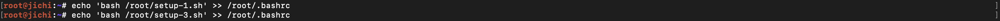

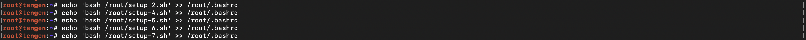

Restart node `tengen` dan `jichi` untuk mengecek apakah autostart berfungsi. Bisa dilakukan secara manual di GNS atau cukup restart service-nya:

```bash
service isc-dhcp-server restart   # tengen
service isc-dhcp-relay restart    # jichi
```

Cek di node berikut

```bash
service isc-dhcp-server status    # tengen, harus active/running
ps aux | grep [d]hcrelay          # jichi, berjalan di eth2 eth3 eth4
```

Uji coba ulang di client (`itadori` atau `zenin`), harus dapat IP sesuai pool masing-masing

```bash
udhcpc -i eth0 -n
```

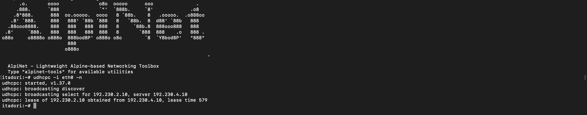

<br/>

| Node                   | IP                            | Fungsi                                  |
| ---------------------- | ----------------------------- | --------------------------------------- |
| jichi                  | 192.230.1.1, .2.1, .3.1, .4.1 | Router/NAT/relay                        |
| utahime                | 192.230.1.2                   | BIND9 master                            |
| shoko                  | 192.230.1.3                   | BIND9 slave                             |
| gojo                   | 192.230.1.4                   | Reverse proxy publik, cache, rate limit |
| geto                   | 192.230.4.2                   | Load balancer API                       |
| maki / panda           | 192.230.4.3 / .4.4            | Web frontend                            |
| nanami / todo / kirara | 192.230.4.5 / .4.6 / .4.7     | API utama / utama / cadangan            |
| yaga / inumaki         | 192.230.4.8 / .4.9            | MariaDB master / slave                  |
| kusakabe               | DHCP                          | Client untuk Apache Benchmark           |

<br/>

Sebelum masuk ke soal 11 jalankan `setup.sh` di node `utahime`, `shoko`, `yaga`, `inumaki`, `maki`, `panda`, `nanami`, `todo`, `kirara`, `geto`, & `gojo`.

<br/>

Script ini berfungsi sebagai mempersiapkan IP dan memasang paket <br/>

```bash
bash setup.sh
```

#### Soal 11

Utahime dan Shoko ditugaskan membangun sistem penamaan domain resmi agar seluruh pos tidak perlu menghafal alamat IP mentah. Konfigurasikan BIND9 pada utahime sebagai DNS Master dan shoko sebagai DNS Slave untuk mengelola domain jujutsu.<xxxx>.com. Atur SOA record, NS delegasi untuk kedua server, dan terapkan allow-transfer dari Master ke Slave. Pastikan file zona berhasil tersinkronisasi otomatis ke shoko saat nomor serial di utahime dinaikkan, lalu buktikan dengan melakukan query dig ke kedua server dari salah satu client.

<br/>
Jalankan ``dns-master.sh`` di node ``utahime`` <br/>

```bash
bash dns-master.sh
```

Jalankan `dns-slave.sh` di node `shoko` <br/>

```bash
bash dns-slave.sh
```

Cek di node

```bash
dig @192.230.1.2 jujutsu.k38.com SOA +noall +answer
dig @192.230.1.3 jujutsu.k38.com SOA +noall +answer
dig @192.230.1.2 jujutsu.k38.com NS +noall +answer
dig @192.230.1.3 jujutsu.k38.com NS +noall +answer
```

Jalankan `serial.sh` di node `utahime` <br/>

```bash
bash serial.sh
```

Cek di node

```bash
dig @192.230.1.2 jujutsu.k38.com SOA +noall +answer
dig @192.230.1.3 jujutsu.k38.com SOA +noall +answer
```

<br/>

#### Soal 12

Peta domain harus memetakan pintu masuk utama dan tetap bisa mencari alamat di luar kawasan Shibuya. Pada utahime, buat A record jujutsu.<xxxx>.com yang mengarah ke gojo, serta CNAME www yang merujuk ke domain utama tersebut. Buat pula Reverse DNS (zona PTR) untuk melacak IP gojo kembali ke domain resminya, dan aktifkan fitur DNS Forwarder pada BIND9 mengarah ke IP gateway internet (192.168.122.1). Uji dari client dengan dig untuk mengecek CNAME, PTR, dan buktikan client tetap bisa melakukan ping ke domain internet seperti google.com.

<br/>

Jalankan `dns-record-master.sh` di node `utahime` <br/>

```bash
bash dns-record-master.sh
```

Jalankan `dns-record-slave.sh` di node `shoko` <br/>

```bash
bash dns-record-slave.sh
```

Cek di node

```bash
dig @192.230.1.2 jujutsu.k38.com A +noall +answer
dig @192.230.1.2 www.jujutsu.k38.com CNAME +noall +answer
dig @192.230.1.2 -x 192.230.1.4 +noall +answer
dig @192.230.1.3 -x 192.230.1.4 +noall +answer
dig @192.230.1.2 google.com A +short
cat /etc/resolv.conf
ping -c 3 google.com
```

<br/>

#### Soal 13

Kepala Sekolah Yaga dan Inumaki mendirikan database terpusat yang redundan agar log aktivitas kutukan tetap aman tersimpan. Konfigurasikan MariaDB pada yaga sebagai DB-Master dan inumaki sebagai DB-Slave. Buat database db*shibuya*<xxxx> beserta tabel request_logs di Master, aktifkan binary logging (log-bin, server-id), lalu hubungkan inumaki sebagai Slave yang menyalin data secara realtime dengan CHANGE MASTER TO. Berikan hak akses remote bagi seluruh node di Network 4, lalu buktikan replikasi berhasil dengan memasukkan data baru di Master dan memeriksa hasilnya di Slave.

<br/>

Jalankan `database-master.sh` di node `yaga` <br/>

```bash
bash database-master.sh
```

Jalankan `database-slave.sh` di node `inumaki` <br/>

```bash
bash database-slave.sh
```

<br/>

#### Soal 14

Para penyihir lapangan bersiaga di Data Center sebagai pekerja backend untuk memproses aplikasi. Pasang Nginx dan PHP-FPM pada maki dan panda untuk menyajikan web frontend yang menampilkan hostname masing-masing. Pada nanami, todo, dan kirara, siapkan layanan API yang mencatat log request ke database yaga. Konfigurasikan virtual host agar worker merespons domain layanan yang ditentukan. Batasi akses langsung dari klien ke worker, web worker hanya menerima trafik melalui jalur proxy web yang ditentukan, sedangkan worker API hanya menerima trafik melalui geto. Uji bahwa akses langsung dari klien ditolak, sementara akses melalui reverse proxy tetap berhasil.

<br/>

Jalankan `setup-worker.sh` di node `maki`, `panda`, `nanami`, `todo`, & `kirara`

<br/>

```bash
bash database-slave.sh <nama node>
```

Cek di node

```bash
for ip in 192.230.4.3 192.230.4.4 192.230.4.5 192.230.4.6 192.230.4.7; do
  curl -s -o /dev/null -w "$ip HTTP=%{http_code}\n" -H 'Host: jujutsu.k38.com' "http://$ip/"
done
curl -i http://jujutsu.k38.com/
curl -i http://jujutsu.k38.com/api
```

#### Soal 15

Geto bertugas mengendalikan pembagian beban request API di internal Data Center agar server tidak tumbang bersamaan. Konfigurasikan Nginx pada geto sebagai Load Balancer internal dengan upstream api_cluster yang mengarahkan trafik ke nanami dan todo. Terapkan algoritma Weighted Round Robin dengan bobot 3:1, di mana nanami menerima porsi beban tiga kali lebih banyak daripada todo. Buktikan distribusi beban ini dengan melakukan loop request berulang kali ke geto dari jaringan lokal Data Center dan periksa rasio responnya.

<br/>

Jalankan `load-balancer.sh` & `load-balancer-test` di node `geto` <br/>

```bash
bash load-balancer.sh
```

```bash
bash load-balancer-test
```

<br/>

#### Soal 16

Gojo berdiri di perbatasan DMZ sebagai gerbang publik tunggal bagi seluruh client dari luar maupun dalam. Konfigurasikan Nginx pada gojo untuk melayani domain jujutsu.<xxxx>.com dan www.jujutsu.<xxxx>.com menggunakan metode Path-Based Routing. Atur agar request root (/) diteruskan secara Round Robin ke worker frontend (maki dan panda), sedangkan request ke path /api diteruskan langsung ke geto. Uji dari client Divisi A atau B bahwa akses ke web utama dibalas oleh Maki/Panda, sedangkan akses ke /api diteruskan dan dijawab oleh Nanami/Todo.

<br/>

Jalankan `reverse-proxy.sh` di node `gojo` <br/>

```bash
bash reverse-proxy.sh
```

Cek di node

```bash
for i in 1 2 3 4 5 6; do curl -s "http://jujutsu.k38.com/?rr=$i"; done
curl -i http://www.jujutsu.k38.com/
curl -i http://jujutsu.k38.com/api
```

<br/>

#### Soal 17

Komando pusat perlu mengetahui IP asli klien yang mengirimkan request tanpa tertukar dengan IP proxy perantara. Konfigurasikan gojo dan geto agar meneruskan informasi alamat klien melalui header X-Real-IP dan X-Forwarded-For. Pastikan geto hanya mempercayai informasi alamat klien yang diterima dari proxy terpercaya, dan skrip API menyimpan alamat klien yang telah diverifikasi ke kolom client_ip pada tabel request_logs di database yaga. Uji dengan mengirimkan request dari klien Network 2 dan Network 3 ke endpoint /api, kemudian periksa database untuk memastikan alamat yang tercatat sesuai dengan IP klien asal, bukan IP gojo atau geto.

<br/>

Jalankan `real-client-ip.sh` di node `geto` <br/>

```bash
bash real-client-ip.sh
```

Cek di node

```bash
ip -4 addr show eth0
curl -s http://jujutsu.k38.com/api
curl -s -H 'X-Real-IP: 8.8.8.8' -H 'X-Forwarded-For: 8.8.8.8' http://jujutsu.k38.com/api
```

di node yaga

```bash
mariadb db_shibuya_K38 -e 'SELECT id,worker,client_ip,method,path,created_at FROM request_logs ORDER BY id DESC LIMIT 12;'
```

<br/>

#### Soal 18

nanami dan todo merupakan worker API utama, sedangkan kirara disiapkan sebagai worker cadangan. Konfigurasikan upstream api_cluster pada geto agar kirara menjadi server backup, serta terapkan passive health check dengan parameter max_fails=2 dan fail_timeout=5s pada worker API utama. Pastikan kirara menjalankan layanan API yang kompatibel dengan endpoint utama. Simulasikan gangguan dengan menghentikan layanan Nginx atau layanan API pada nanami dan todo. Buktikan dari klien bahwa request ke /api dialihkan ke kirara dan menghasilkan respons API yang valid tanpa error 502 Bad Gateway.

<br/>

Jalankan `api-failover.sh` di node `geto` <br/>

```bash
bash api-failover.sh
```

```bash
# Pada nanami DAN todo
service nginx stop

# Pada client (jeda agar tidak mencampur uji dengan rate limit)
for i in 1 2 3 4 5 6; do
  curl -s -w ' HTTP=%{http_code}\n' http://jujutsu.k38.com/api
  sleep 1
done

# Setelah mengambil bukti: hidupkan kembali pada nanami DAN todo
service nginx start
```

<br/>

#### Soal 19

gojo bertugas mengoptimalkan layanan web sekaligus membatasi request berlebihan. Konfigurasikan Nginx Proxy Caching untuk halaman web frontend dengan masa berlaku cache 10 menit dan tambahkan header X-Cache-Status. Terapkan rate limiting pada path /api dengan batas 10 request per detik per IP klien. Buktikan bahwa request ke halaman web yang memenuhi syarat cache menghasilkan status MISS pada akses awal dan HIT pada akses berikutnya. Uji rate limiting secara terpisah dengan mengirimkan request beruntun ke /api, kemudian catat status respons yang dihasilkan ketika batas terlampaui.

<br/>

Jalankan `cache-rate-limit.sh` di node `gojo`

```bash
bash cache-rate-limit.sh
```

```bash
# Pada client: gunakan URL sama dua kali agar terlihat MISS lalu HIT
key=$(date +%s)
curl -i "http://jujutsu.k38.com/?cachetest=$key"
curl -i "http://jujutsu.k38.com/?cachetest=$key"

# Pada client: uji API secara paralel
seq 1 100 | xargs -P 30 -I '{}' curl -s -o /dev/null -w '%{http_code}\n' http://jujutsu.k38.com/api | sort | uniq -c
```

<br/>

#### Soal 20

Sebelum Curtain di Shibuya resmi dibuka, Kusakabe memimpin audit untuk menguji kapasitas layanan. Dari terminal kusakabe, jalankan benchmark menggunakan Apache Benchmark dengan parameter -n 600 -c 30 menuju http://jujutsu.<xxxx>.com/. Catat Requests per Second (RPS), latensi, dan jumlah request yang gagal. Lakukan pengujian tambahan pada endpoint /api untuk mengamati efek rate limiting. Bandingkan hasil pengujian baseline dengan hasil ketika rate limiting aktif, serta gunakan access log gojo untuk membedakan kegagalan aplikasi, koneksi, dan request yang ditolak oleh kebijakan rate limit.

<br/>

Jalankan `rate-mode.sh baseline` di node `gojo`

```bash
bash rate-mode.sh baseline
```

Jalankan `benchmark.sh baseline` di node `kusakabe`

```bash
bash benchmark.sh baseline
```

Jalankan `rate-mode.sh active` di node `gojo`

```bash
bash rate-mode.sh active
```

Jalankan `benchmark.sh active` di node `kusakabe`

```bash
bash benchmark.sh active
```
